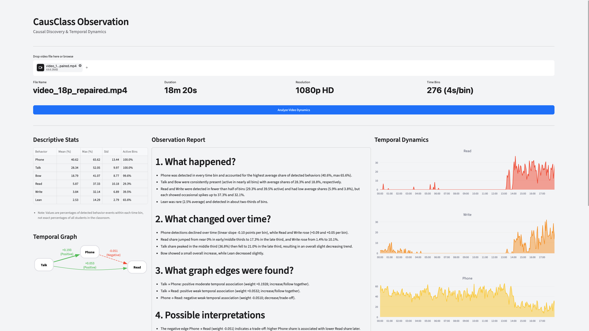
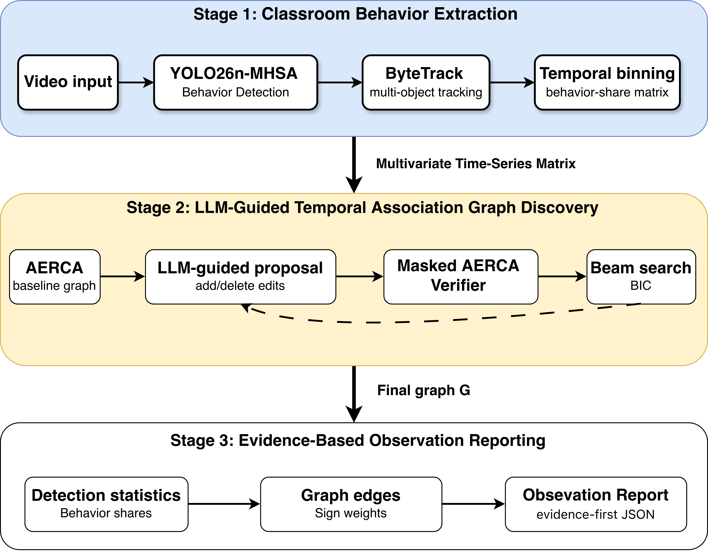

<div align="center">

# CausClass

### From classroom video to auditable temporal behavior graphs

CausClass combines **YOLO26n-MHSA perception**, **AERCA neural verification**, and **LLM-guided beam search** to turn classroom video into behavior timelines, temporal graphs, and evidence-first observation reports.

[](https://github.com/longnt27/CausClass/actions/workflows/ci.yml)


[](LICENSE)

[Results](#results) · [Demo](#real-classroom-video) · [Quick start](#quick-start) · [Pipeline](#run-the-full-pipeline) · [Report](#thesis-report) · [Reproducibility](docs/reproducibility.md)

</div>

## Results

The thesis evaluates all three parts of the system: behavior detection on two classroom datasets, temporal graph recovery on 100 synthetic suites with known ground truth, and the complete pipeline on an 18-minute real classroom video.

| Detector ablation | Graph recovery | Controlled evaluation | End-to-end case study |
| :---: | :---: | :---: | :---: |
| **+6.38 pp Recall** | **0.5043 F1** | **100 test suites** | **18m 20s video** |
| MHSA vs. base YOLO26n, two-dataset mean | Best result: LLM Beam | Known graph ground truth | 276 four-second bins |

> [!NOTE]
> These are real experiment results reported by the thesis protocol. The current code includes result-changing protocol-v2 corrections, so a new run is a new result set—not a byte-for-byte reproduction of the historical tables. See [Reproducibility](#reproducibility-and-evidence-status).

### Behavior detection: MHSA improves Recall and mAP

YOLO26n and YOLO26n-MHSA were compared on the five labels shared by the cleaned Local dataset and the SCB subset: `Read`, `Write`, `Phone`, `Bow`, and `Lean`.

| Dataset | Model | Precision | Recall | mAP@50 | mAP@50–95 |
| --- | --- | ---: | ---: | ---: | ---: |
| Local | YOLO26n | **0.8296** | 0.7922 | 0.8320 | 0.6550 |
| Local | **YOLO26n-MHSA** | 0.8240 | **0.8568** | **0.8730** | **0.6966** |
| SCB | YOLO26n | **0.8614** | 0.8292 | 0.8994 | 0.6980 |
| SCB | **YOLO26n-MHSA** | 0.8506 | **0.8922** | **0.9084** | **0.7096** |
| **Two-dataset mean** | YOLO26n | **0.8455** | 0.8107 | 0.8657 | 0.6765 |
| **Two-dataset mean** | **YOLO26n-MHSA** | 0.8373 | **0.8745** | **0.8907** | **0.7031** |

Across both datasets, MHSA raised mean Recall by **6.38 percentage points**, mAP@50 by **2.50 points**, and mAP@50–95 by **2.66 points**. Precision decreased by 0.82 points, making the trade-off explicit rather than hiding it. The largest class-level gain was Local `Read` mAP@50: **0.470 → 0.574**.

The evaluation covers 544 Local images with 10,929 instances and a 2,132-image SCB subset with 35,225 instances. Full dataset, split, and per-class results are in [the detector evaluation](report/sections/4.1.tex) and [MHSA ablation](report/sections/4.2.tex).

### Temporal graph recovery: LLM Beam performs best

Stage 2 uses 100 independently generated VAR(1) suites. Each suite contains a hidden directed graph and a noisy 1,000-step, six-variable time series. The graph-search model never sees the ground truth; it is used only to score the final recovered edges.

| Method | F1 ↑ | Precision ↑ | Recall ↑ | Mean edges |
| --- | ---: | ---: | ---: | ---: |
| AERCA-init, `q=0.40` | 0.2233 | 0.1264 | **0.9700** | 22.00 |
| AERCA-best, `q=0.85` | 0.3306 | 0.2450 | 0.5133 | 6.00 |
| AERCA-strict, `q=0.90` | 0.3133 | 0.2700 | 0.3767 | 4.00 |
| Random Beam | 0.0740 | 0.0808 | 0.0733 | 1.47 |
| LLM Greedy | 0.4160 | 0.3074 | 0.8600 | 10.57 |
| **LLM Beam (proposed)** | **0.5043** | **0.4952** | 0.5950 | 3.82 |

LLM Beam improves F1 by **0.1737** over the best thresholded AERCA baseline and by **0.1910** over the density-matched AERCA-strict graph. Random Beam collapses to 0.0740 F1, showing that the gain does not come from beam search alone; useful semantic proposals, masked neural verification, and multi-candidate search are all needed.

Gemini 3.0 Flash generated the ground-truth graphs, while DeepSeek-v4-Flash proposed edits without access to those graphs. The complete setup, standard deviations, BIC/MSE diagnostics, and interpretation are in [the benchmark protocol](report/sections/4.3.tex) and [graph-search ablation](report/sections/4.4.tex).

### Real classroom video

The end-to-end case study processes a **1080p, 18m 20s classroom video** into 276 four-second time bins, a signed three-edge temporal graph, time-series plots, searchable debug frames, and a structured observation report.

<p align="center">
  
</p>

The selected graph contained:

```text
Talk  → Phone   +0.1928
Talk  → Read    +0.0532
Phone → Read    -0.0510
```

The report also surfaced the main temporal change: detected `Phone` event share declined while `Read` and `Write` rose sharply in the final third. These are shares of **detected behavior-events**, not percentages of students, and the graph represents observational temporal associations—not proven causes.

See the [full case study](report/sections/4.5.tex) for descriptive statistics, trend coefficients, graph interpretation, and the manual video-review checklist.

## What the system produces

Every full run leaves an audit trail rather than only a final prediction:

| Artifact | Evidence retained |
| --- | --- |
| `*_micro_events.json` | Per-track behavior segments and timestamps |
| `*_raw_timeseries.csv` | Behavior-event shares for every time bin |
| `debug_frames/` | Periodic annotated frames for visual review |
| `*_timeseries_plot.png` | Behavior dynamics across the recording |
| `*_final_graph.json` / `*.csv` | Directed, signed, weighted temporal edges |
| `*_final_graph.png` | Human-readable graph visualization |
| `*_search_log.json` | Proposals, verifier scores, accepted edits, and beam survivors |
| `*_observation_report.md` | Optional evidence-first report with review prompts |

## How it works

<p align="center">
  
</p>

1. **Perception:** YOLO26n-MHSA and ByteTrack convert video into tracked behavior events.
2. **Temporal aggregation:** detections become a multivariate behavior-share time series.
3. **Initial discovery:** AERCA estimates a dense temporal dependency graph.
4. **Graph search:** an LLM proposes one to three edge additions or deletions.
5. **Verification:** masked AERCA retrains each candidate and scores predictive fit with a complexity penalty.
6. **Reporting:** the selected graph, descriptive statistics, and trends become a traceable observation report.

The LLM proposes edits; it does not get to declare them correct. The maintained public graph convention is **source row → target column**, with conversion to SENNGC's coefficient convention only at the verifier boundary. See [architecture.md](docs/architecture.md) for the contract.

## Quick start

The fastest path exercises the real verifier on CPU with **no video, GPU, API key, or paid service**.

### Requirements

- Python **3.11–3.13**
- [`uv`](https://docs.astral.sh/uv/)

```bash
git clone https://github.com/longnt27/CausClass.git
cd CausClass

uv sync --locked --extra dev
uv run --no-sync causclass-smoke --output-dir output/smoke-001 --seed 42
uv run --no-sync pytest --cov
```

The smoke run creates a deterministic VAR fixture, performs dense and masked AERCA training, and writes:

```text
output/smoke-001/
├── time_series.csv
├── ground_truth_graph.json
├── graph.json
├── metrics.json
├── config.json
└── run_metadata.json
```

`run_metadata.json` records the protocol, seed, Git state, package versions, and SHA-256 input digests. The smoke F1 is a software integration check, not a thesis benchmark result. Existing output directories are rejected to prevent accidental overwrite.

## Run the full pipeline

Install the optional runtime groups you need:

```bash
uv sync --locked \
  --extra dev \
  --extra llm \
  --extra vision \
  --extra tracking \
  --extra dashboard

cp .env.example .env
```

Run video → temporal graph discovery:

```bash
uv run --no-sync python -m core.end_to_end_pipeline \
  --video /path/to/consented-classroom.mp4 \
  --model data/best.pt \
  --output_dir output/runs/classroom-001 \
  --skip_teacher_advice
```

Or run the stages independently:

```bash
# Video → behavior time series
uv run --no-sync python -m data.extract_video_dynamics /path/to/consented-classroom.mp4 \
  --model data/best.pt \
  --output-dir output/phase1/classroom-001

# Existing CSV → temporal graph
uv run --no-sync python -m core.run_causal_discovery \
  --input output/phase1/classroom-001/classroom_multivariate_timeseries.csv \
  --output output/final_causal_graph.json
```

The maintained standalone CSV ontology is:

```text
Talk, Read, Phone, Write, Lean, Bow
```

optionally preceded by `time_bin_sec`.

### External services

- `DEEPSEEK_API_KEY` — graph-edit proposals and optional reports.
- `GEMINI_API_KEY` — synthetic-data generation workflows.
- `WANDB_MODE=disabled` — recommended unless experiment telemetry is explicitly approved.

Provider-backed commands can incur charges and transmit data outside your machine. Environment variables take precedence over `.env`.

### Artifact viewer

```bash
uv run --no-sync streamlit run app.py
```

The viewer opens completed artifacts locally; it does not rerun the research pipeline.

## Reproducibility and evidence status

The repository distinguishes three claims that are easy to conflate:

| Evidence | What it establishes |
| --- | --- |
| Thesis tables | Results of the documented historical experiments |
| Protocol-v2 tests and CI | Correct execution and regression coverage of the current software |
| CPU smoke F1 | End-to-end verifier integration on a tiny deterministic fixture |

Protocol v2 corrects graph-direction conversion, Gaussian KL, graph-selection leakage, boundary cases, and ontology consistency. Those changes affect methodology, so current reruns must be reported separately from the thesis values above.

The tracked tree does not contain all original training data, every synthetic suite, or complete historical run manifests. Do not claim an exact thesis reproduction without those artifacts. Future reportable runs should retain the commit, seed, split, configuration, provider/model IDs, prompts and responses, package lock, and input/model checksums. Read [docs/reproducibility.md](docs/reproducibility.md) before publishing comparisons.

## Thesis report

The complete Vietnamese thesis source, figures, appendices, bibliography, and original results are preserved in [`report/`](report/README.md) with import provenance and original Git history.

Build the PDF from the repository root:

```bash
make report
```

The output is written to `report/build/main.pdf`. CI also builds and uploads the PDF and complete log.

## Repository map

```text
CausClass/
├── core/                  # graph search, verifier, experiments, smoke CLI
│   ├── models/            # adapted AERCA / SENNGC implementation
│   └── legacy/            # historical runners kept for traceability
├── data/                  # perception and synthetic-data utilities
├── tests/                 # API-free regression and CPU integration tests
├── docs/                  # architecture, reproducibility, and ethics
├── report/                # complete thesis source, figures, and results
├── refs/                  # retained third-party papers
├── app.py                 # local artifact viewer
├── pyproject.toml         # package and optional dependency groups
├── uv.lock                # locked CPU reference environment
├── Dockerfile             # non-root, offline smoke image
└── CITATION.cff           # software citation metadata
```

## Research scope and responsible use

Classroom video can contain sensitive personal data. Process only data you are authorized to use, document consent and access conditions, and review [data-and-ethics.md](docs/data-and-ethics.md) before redistributing images, weights, or derived datasets.

CausClass discovers **observational temporal dependencies**, not intervention-proven causality. Detection errors, omitted variables, camera conditions, compositional behavior shares, and temporal aggregation can all change the graph. Use the outputs for review and hypothesis generation—not automated grading, discipline, or other high-stakes student decisions.

## Development

Before changing scientific behavior, read [CONTRIBUTING.md](CONTRIBUTING.md) and the [reproduction protocol](docs/reproducibility.md).

```bash
uv sync --locked --extra dev
make lint
uv run --no-sync pytest --cov
```

Existing `python -m core...` and `python -m data...` entry points are retained for experiment compatibility.

## Citation

If you use CausClass, cite the software with [`CITATION.cff`](CITATION.cff), record the exact commit, and cite the original AERCA paper:

```bibtex
@inproceedings{han2025root,
  title={Root Cause Analysis of Anomalies in Multivariate Time Series through Granger Causal Discovery},
  author={Xiao Han and Saima Absar and Lu Zhang and Shuhan Yuan},
  booktitle={The Thirteenth International Conference on Learning Representations},
  year={2025},
  url={https://openreview.net/forum?id=k38Th3x4d9}
}
```

## License and third-party material

The repository retains its existing [MIT license](LICENSE). Adapted AERCA/SENNGC code, report material, reference papers, datasets, images, and model weights may carry separate provenance or redistribution requirements. Review [THIRD_PARTY_NOTICES.md](THIRD_PARTY_NOTICES.md) before reuse or redistribution.
